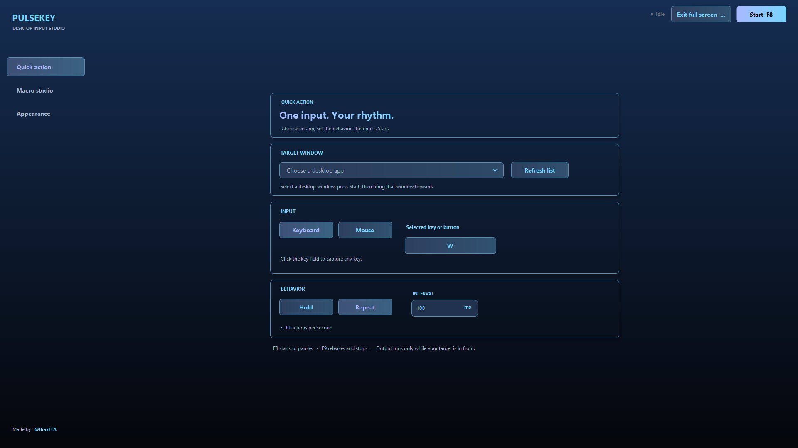
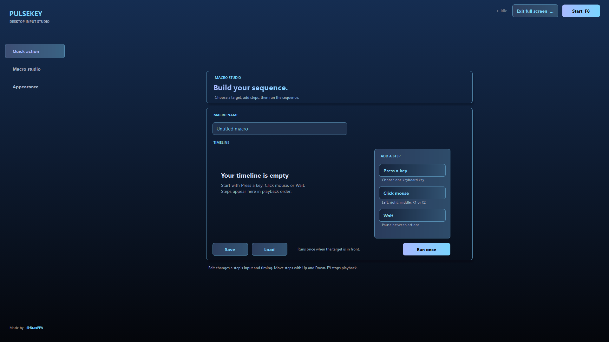
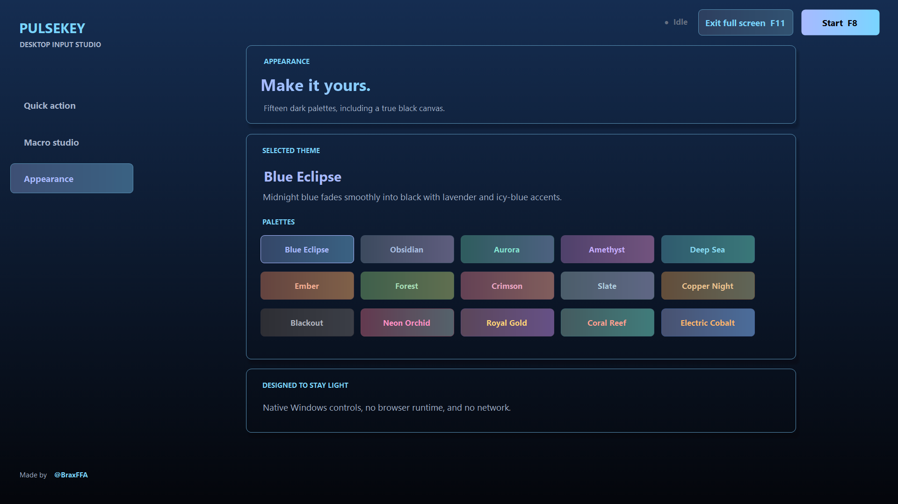

# PulseKey

**A compact Windows input studio for a single held or repeated input and manually built macros.**

Made by [@BraxFFA](https://linktr.ee/BraxFFA).

PulseKey is a portable 64-bit Windows app built with Windows Forms and the .NET Framework. It has three simple screens: **Quick action**, **Macro studio**, and **Appearance**. There is no installer, browser runtime, background service, kernel driver, or account.

## Download

Get `PulseKey-v1.0.3-win-x64.zip` from [Releases](../../releases). Extract it to a folder, then run `PulseKey.exe`. A standalone executable and `SHA256SUMS-v1.0.3.txt` are also attached to the release.

> Windows may display a SmartScreen prompt for an unsigned app. Review the source and the release checksum before choosing whether to run it. The release is not code signed.

## At a glance

| Area | What it does |
| --- | --- |
| Quick action | Choose a visible window, keyboard key or mouse button, then hold or repeat it while that window is in front. |
| Macro studio | Build a sequence from key presses, mouse clicks, and waits. Edit, reorder, save, load, and run it once. |
| Appearance | Choose from 15 dark themes with smooth window-wide gradients and two coordinated accent colors. |

- **Hold or repeat:** Repeat interval is adjustable from 50 to 10,000 ms; the app displays the approximate actions per second.
- **Controls:** `F8` starts or stops a quick action; `F9` stops and releases any held input; `F11` enters or exits full screen. The same actions have visible buttons.
- **States:** **Idle** means stopped, **Armed** means waiting for the selected window, and **Active** means output is running while that window is in front.
- **Target scope:** PulseKey enumerates ordinary visible top-level windows. It pauses output when the target loses focus and stops if that window closes.
- **Portable:** One executable, an icon, and a local settings file. No telemetry or automatic network requests.
- **Large-window layout:** Maximizing or entering full screen grows the cards, controls, text, sidebar, and header to fit the display while keeping the working area centered.

## Quick start

1. Download and extract the release ZIP.
2. Open `PulseKey.exe` and choose a **Target window** on **Quick action**. If it is missing, open the other app and press **Refresh list**.
3. Choose **Keyboard** or **Mouse**, then the input you want.
4. Choose **Hold** or **Repeat**. For Repeat, set the interval in milliseconds.
5. Press **Start** or `F8`, then bring the target to the front. Press `F9` to stop and release. Use **Full screen** or `F11` to fill the display, and use it again to restore the window.

For macros, open **Macro studio**, add steps to the timeline, and use **Run once**. Save and load sequences as `.pulse.xml` files. See the [full usage guide](docs/USAGE.md).

## Screenshots

| Macro studio in full screen | Theme picker in full screen |
| --- | --- |
|  |  |

[Shift macro step in full screen](docs/images/fullscreen-shift-step.png) · [See all 15 themes](docs/images/all-themes.png) · [Neon Orchid](docs/images/neon-orchid.png) · [Blackout](docs/images/blackout.png)

## Input and game compatibility

PulseKey uses Windows `SendInput`. Where Windows provides a scan code for a selected key, the app sets the scan-code flag in the synthetic keyboard event. This **does not create physical hardware input**, install a driver, or make the app undetectable. Protected apps and games may reject or flag synthetic input. A game appearing in the target list only means its window was enumerated; it does not prove input delivery or compliance with that game's rules. Use PulseKey only where automation is allowed.

## Privacy and resources

- Settings live in `%LOCALAPPDATA%\PulseKey\settings.txt`.
- Saved macro files are written only when you choose **Save**; they can be reopened with **Load**.
- PulseKey makes no automatic network requests. Clicking the **@BraxFFA** credit opens [Linktree](https://linktr.ee/BraxFFA) in your default browser.
- The theme gradient uses a cached eight-pixel-wide strip. It updates when the theme or window height changes, so full-screen width does not multiply the cache size. An open GUI process cannot use literally zero resources.
- Closing the app stops actions and releases a held key or mouse button.

## Documentation

- [Usage and macro format](docs/USAGE.md)
- [Themes](docs/THEMES.md)
- [Build from source](docs/BUILD.md)
- [Microsoft Store release workflow](docs/STORE.md)
- [Privacy policy](PRIVACY.md)
- [Troubleshooting](docs/TROUBLESHOOTING.md)
- [Security and reporting](SECURITY.md)
- [Changelog](CHANGELOG.md)

## Source and credit

The complete application is in [`src/PulseKey.cs`](src/PulseKey.cs). The Windows icon is in [`assets/PulseKey.ico`](assets/PulseKey.ico). Release archives are built from this source and icon.

**Created by [@BraxFFA](https://linktr.ee/BraxFFA).** Copyright © 2026 @BraxFFA. See [LICENSE](LICENSE) for the terms.
