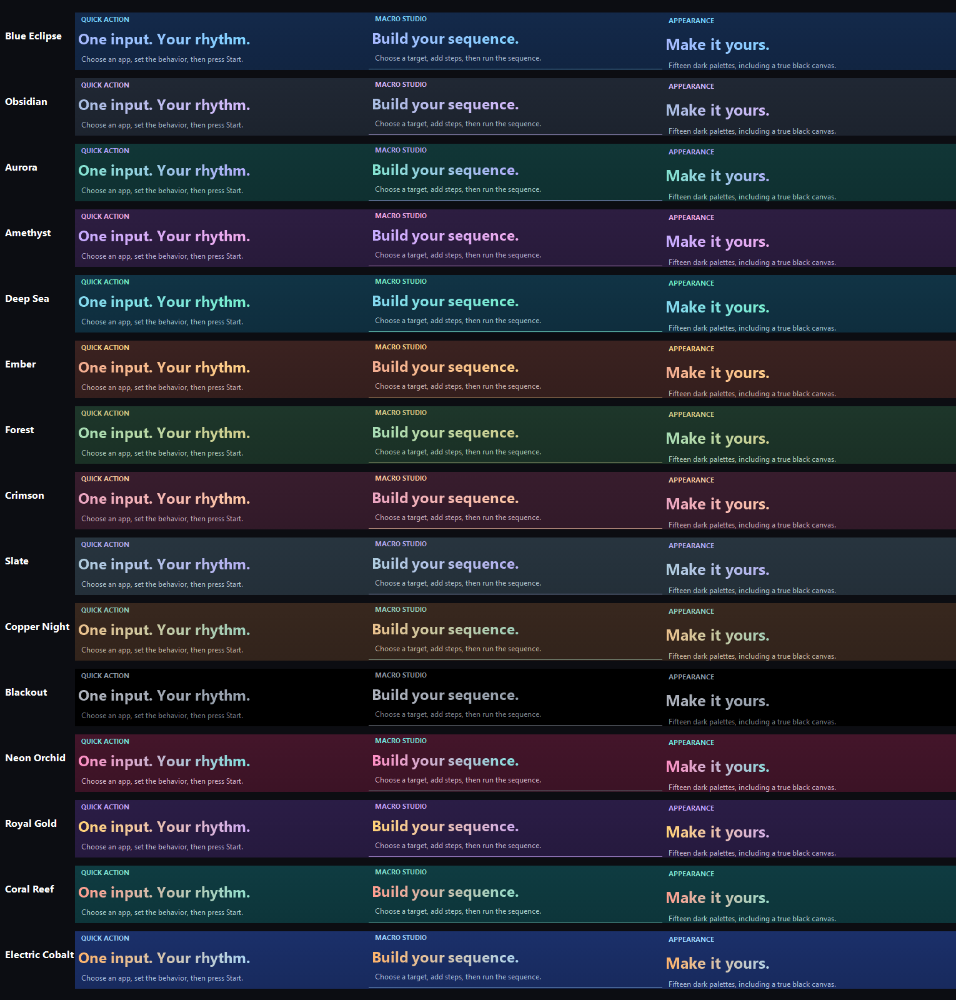

# Themes

PulseKey offers 15 dark themes. Each uses a smooth gradient across the full application window, coordinated primary and secondary accents, and restrained rounded controls.

| Theme | Palette |
| --- | --- |
| Blue Eclipse | Midnight blue into black; lavender and ice blue |
| Obsidian | Graphite and black; steel blue and violet |
| Aurora | Deep teal into black; mint and twilight violet |
| Amethyst | Ink purple; violet and orchid pink |
| Deep Sea | Ocean blue; cyan and seafoam |
| Ember | Dark charcoal red; coral and warm gold |
| Forest | Evergreen; sage and soft gold |
| Crimson | Burgundy black; rose and peach |
| Slate | Cool slate; ice blue and violet |
| Copper Night | Smoky brown black; copper and verdigris |
| Blackout | True black; graphite controls and soft gray text |
| Neon Orchid | Raspberry pink into black; vivid pink and turquoise |
| Royal Gold | Velvet violet; warm gold and lilac |
| Coral Reef | Tropical teal; coral and sea glass |
| Electric Cobalt | Saturated cobalt into black; tangerine and ice blue |

The full-window gradient is a cached bitmap. It is regenerated when the theme or window size changes, with subtle dithering to reduce visible color banding. Theme selection does not run an idle animation timer.
